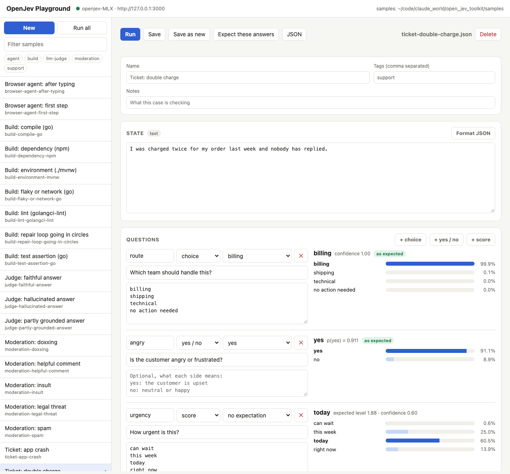
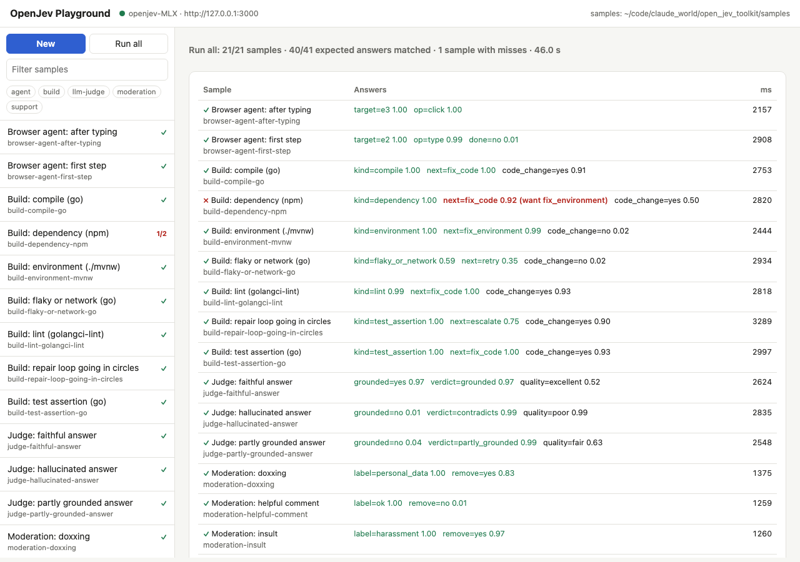
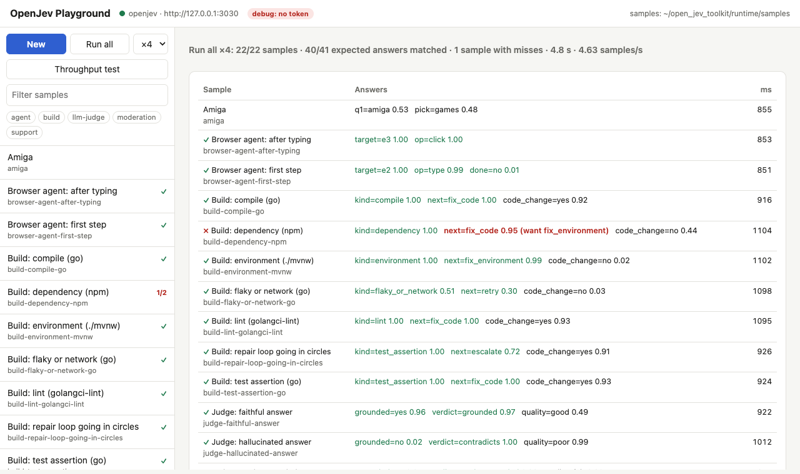
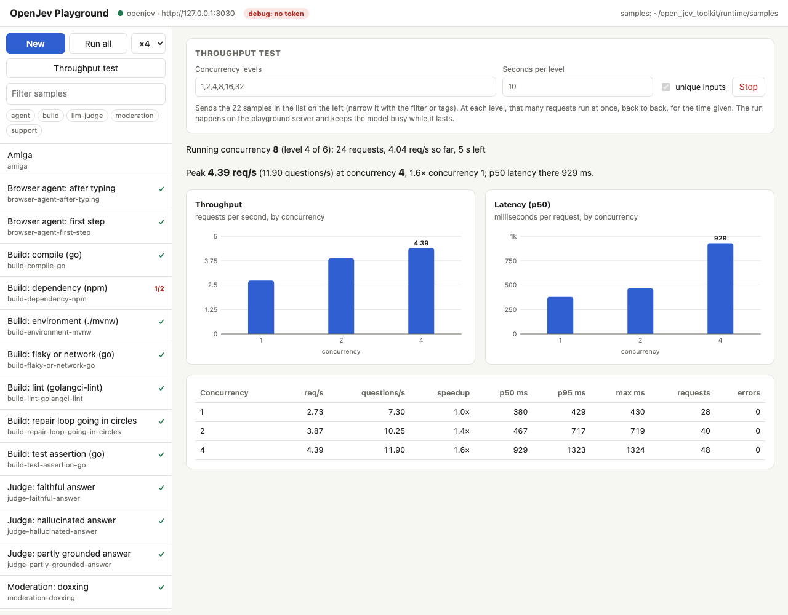

# OpenJev toolkit

Run [OpenJev](https://huggingface.co/openjev) locally on Apple silicon (MLX) or on Linux with an
NVIDIA GPU (vLLM, including DGX Spark), with an installer, a server script, a small Python client and
worked examples. Both serve the same API, so everything else in this toolkit works on either.

OpenJev is a **decision model**, not a chat model. You send a *state* (text, or JSON such as a log
tail, a ticket or a DOM) and typed questions with your own labels. You get back calibrated answers
from one forward pass per question:

| type | you send | you get |
|---|---|---|
| `choice` | up to 52 labels (more run in passes), optional descriptions | winning label, probability per label, confidence |
| `noul` (yes/no) | a statement or question | probability of yes |
| `score` | ordered levels, lowest first | expected level, distribution, confidence |

You don't train it per task: labels and policy text go in the request.

## One-line install

```bash
curl -fsSL https://raw.githubusercontent.com/geekychris/open_jev_toolkit/main/scripts/install.sh | bash
```

This clones into `~/open_jev_toolkit` (override with `OPENJEV_HOME`) and runs the installer from
there. From a checkout, run `scripts/install.sh` directly. Pass options after `bash -s --`:

```bash
curl -fsSL .../scripts/install.sh | bash -s -- --profile flash-4bit
```

The installer detects the machine (Apple silicon, or Linux where `nvidia-smi` sees a GPU) and:
- installs `uv` if it's missing;
- builds `runtime/venv` on Python 3.12, using the MLX or vLLM stack versions the model cards were validated with;
- downloads the model at a pinned revision, plus the upstream helper (`shim.py`, whose sha256 is checked);
- runs a self-check.

Everything it creates lives under `runtime/`, which is git-ignored.

### Profiles

On Apple silicon:

| profile | build | disk | minimum RAM | notes |
|---|---|---|---|---|
| `27b-8bit` | `openjev/openjev-MLX` | 27 GB | 64 GB | default on 64 GB or more; same accuracy as the served 16-bit model (84.0% on the card's 10k set) |
| `27b-4bit` | `openjev/openjev-MLX-4bit` | 15 GB | 32 GB | default on 32 GB or more |
| `flash-8bit` | `openjev/OpenJev-Flash-9B-MLX` | 10 GB | 24 GB | 9B; 81.4% on JevBench |
| `flash-4bit` | `openjev/OpenJev-Flash-9B-MLX-4bit` | 5 GB | 16 GB | default below 32 GB; 80.5% on JevBench; fastest |

Every profile carries the calibration constants (`READOUT_T`, `READOUT_NOUL_T`) that its model card
gives. You can install several profiles and switch between them with `serve.sh start --profile ...`.

On NVIDIA (see [NVIDIA GPUs](#nvidia-gpus-vllm-including-dgx-spark)):

| profile | build | download | minimum GPU memory | notes |
|---|---|---|---|---|
| `27b-fp8` | `openjev/openjev` | 55 GB | 48 GB | default with 48 GB or more; the setup the model card's numbers were measured on |
| `flash-fp8` | `openjev/OpenJev-Flash-9B` | 19 GB | 24 GB | default below 48 GB; the JevBench setup |

The MLX builds are **text only**: they take JSON, DOM and logs, but not screenshots. The NVIDIA
profiles also accept one image per request (`screenshot` or `image` in the state).

## Run

```bash
scripts/serve.sh start            # background, waits until ready; http://127.0.0.1:3000
scripts/serve.sh status | logs | stop | restart
scripts/serve.sh start --profile 27b-8bit --port 3001
scripts/serve.sh fg               # run in the foreground
```

Environment variables:
- `OPENJEV_PORT`, `OPENJEV_HOST`: where the server listens.
- `SHIM_TOKEN`: if set, requests must send `Authorization: Bearer <token>`. Set it before binding anything other than localhost.

Endpoints: `POST /v1/systemone`, `GET /v1/version`.

`scripts/serve.sh cmd` prints the exact commands `start` would run, useful for running them under
your own supervisor (systemd, a container).

## NVIDIA GPUs (vLLM, including DGX Spark)

On Linux with an NVIDIA GPU, the same commands set up upstream's measured server
(`serve/SERVE.md` in `openjev/openjev`): vLLM 0.29.0 serves the 16-bit weights with online FP8 on
`127.0.0.1:8000`, and the same frozen helper (`shim.py`) runs in front of it on `:3000`.

```bash
scripts/install.sh                     # picks 27b-fp8 or flash-fp8 by GPU memory
scripts/serve.sh start                 # starts vLLM, waits for it, then the helper
scripts/serve.sh status | stop | logs  # both processes
```

Requirements: Linux, an NVIDIA driver that supports CUDA 13 (`nvidia-smi` works), and disk for the
download. The installer installs vLLM with `uv pip --torch-backend=auto`, which picks the CUDA build
of PyTorch matching your driver. The first `start` takes several minutes while vLLM loads, quantises
and compiles; later starts are faster.

**vLLM in Docker.** If vLLM won't install into the venv (no prebuilt wheel for your platform or CUDA
version), run it from a container instead; the helper stays in the venv:

```bash
scripts/install.sh --vllm-image vllm/vllm-openai:v0.29.0     # needs docker + NVIDIA Container Toolkit
scripts/serve.sh start                                       # runs the container "openjev-vllm"
```

The image is remembered in `runtime/active.env`; `VLLM_IMAGE=...` overrides it per command.

**DGX Spark** (GB10, 128 GB unified memory, arm64). The installer sees that the GPU shares system
memory (`nvidia-smi` reports no separate GPU memory) and:
- defaults to `27b-fp8` (about 28 GB of FP8 weights in memory);
- sizes vLLM's share at each start from the memory available then: available minus 12 GB headroom,
  capped at 60%, instead of upstream's 0.90 (which would leave nothing for the OS or other models
  running beside it). It refuses to start, with a clear message, if that is less than the profile
  needs (about 40 GB for `27b-fp8`, 16 GB for `flash-fp8`). This only sizes vLLM's KV cache; answers
  are unaffected. `VLLM_GPU_MEM` fixes the share, `VLLM_HEADROOM_GB` changes the headroom;
- frees reclaimable page cache before starting vLLM. On GB10, CUDA counts only free pages as free
  memory, not file cache, and vLLM won't start if its share is more than that. The script allocates
  memory briefly so the kernel drops clean cache pages (the effect of `drop_caches`, without root).

If the pip install of vLLM fails on Spark's arm64 + CUDA 13, use `--vllm-image` with NVIDIA's vLLM
container for Spark from NGC (`nvcr.io/nvidia/vllm`), or `vllm/vllm-openai:v0.29.0` if it has an arm64
build.

Other settings (all optional):
- `OPENJEV_VLLM_PORT` (8000): vLLM's port. It is always bound to 127.0.0.1 and has no API key; expose
  only the helper, with `SHIM_TOKEN` set.
- `VLLM_GPU_MEM`: vLLM's memory share (0.90; sized from available memory on unified memory).
- `VLLM_TIMEOUT` (1200): seconds to wait for vLLM to come up.
- `VLLM_EXTRA_ARGS`: extra `vllm serve` flags, for troubleshooting. Anything beyond the memory share
  moves you off the measured setup.

Tested on a DGX Spark (GB10, 128 GB, driver 580 / CUDA 13) running `27b-fp8` beside another 47 GB
model: vLLM 0.29.0 installs from pip on arm64, the first start takes about 11 minutes (5 loading
weights, the rest compiling and capturing CUDA graphs), and vLLM uses 29 GB for weights plus a
15.5 GB KV cache. The saved samples match 40 of 41 expectations, the same as `27b-8bit` on MLX, at
0.15 s for one question and 0.2–0.4 s for three, measured on the Spark (about 4–6× the M4 Max).

The installer builds the venv on uv's own Python 3.12: Triton compiles a small C helper when vLLM
starts and needs `Python.h`, which Ubuntu's Python lacks unless `python3.12-dev` is installed.

## Deploy to another machine

`scripts/deploy.sh` sets the toolkit up on another machine over SSH and runs it there as a service.
It clones (or updates) the repo from GitHub on the host, runs the installer, installs a systemd user
service, waits until the API answers, and checks it from your machine:

```bash
scripts/deploy.sh chris@spark.local --profile 27b-fp8 --port 3030 --listen 0.0.0.0
```

- `--listen 0.0.0.0` serves the LAN and generates a bearer token, saved on the host in
  `runtime/active.env` (mode 600). Without `--listen` it stays on the host's localhost and the script
  prints the SSH tunnel to use. vLLM itself is always localhost-only.
- `--port` picks the API port (3000 by default).
- `--profile`, `--vllm-image`: as for `install.sh`. `--ref` deploys another branch; `--no-service`
  installs without starting.
- `--playground` also runs the [playground](#open-it-from-other-machines) on the host as a service on
  port 3020, with a token; `--playground-debug` runs it without one.
- Rerunning it updates the checkout and restarts the service (on NVIDIA that reloads the model, a few
  minutes); downloads already done are skipped.
- It deploys what is pushed to GitHub, not uncommitted local changes.
- It prints the host's IPv4 address as the URL. The helper listens on IPv4 only, and a name that also
  resolves to IPv6 (as `spark.local` does) makes Python clients try each IPv6 address first and wait
  for the refusal, about a second apiece, on every request.

Then, from your machine:

```bash
export OPENJEV_URL=http://192.168.1.227:3030    # the address deploy.sh printed
export SHIM_TOKEN=$(ssh chris@spark.local "grep '^SHIM_TOKEN=' ~/open_jev_toolkit/runtime/active.env | cut -d= -f2-")
runtime/venv/bin/openjev version
runtime/venv/bin/openjev run            # the saved samples, against the remote model
runtime/venv/bin/openjev playground     # the playground, against the remote model
```

On the host, `scripts/service.sh status | logs | restart | stop | uninstall` manages the service
(`logs` follows the helper; vLLM's log is `runtime/vllm.log`). The service starts at boot only if
your user lingers: `service.sh install` enables that when it can, and otherwise asks you to run
`sudo loginctl enable-linger $USER` once.

The installer's `--port` and `--listen` options (and `SHIM_TOKEN`) are saved in `runtime/active.env`,
so `serve.sh` and the service use them without extra flags; environment variables still override them.

## Use it

Raw HTTP: see `examples/01_curl.sh`.

Python, with the stdlib-only client `openjev_client`. The installer puts it in the venv; you can also
`pip install -e .`, or copy the one file into another project:

```python
from openjev_client import Jev, choice, yesno, score

jev = Jev()   # $OPENJEV_URL or http://127.0.0.1:3000
r = jev.ask({"step": "verify", "log_tail": log},
            kind=choice("What kind of failure is this?", {"compile": "...", "test_assertion": "...", "environment": "..."}),
            transient=yesno("Is this failure likely to pass on a plain retry?"))
r["kind"].choice, r["kind"].confidence, r["transient"].p
```

Shell:

```bash
echo "undefined: OrderStatusPending" | runtime/venv/bin/openjev choose "What kind of failure?" compile test lint network
runtime/venv/bin/openjev check "Is the customer angry?" < ticket.txt
```

## Examples

`examples/run_all.sh` runs all of them.

| file | shows |
|---|---|
| `01_curl.sh` | the raw API: three question types in one request |
| `02_basic.py` | ticket routing, sentiment, urgency |
| `03_moderation.py` | your own policy as option descriptions |
| `04_llm_judge.py` | judging another model's answer: grounded, verdict, quality |
| `05_agent_step.py` | a browser-agent step: which element, which operation, done or not |
| `06_build_failure_triage.py` | classifying a failed build/test log and choosing retry, fix code, fix env or escalate; includes expected labels, so it doubles as an eval |
| `07_cloudstack_adapter.py` | a cloud_stack-format request through the adapter (needs `scripts/cloudstack-adapter.sh start`) |

To try your own inputs interactively, use the [playground](#playground-and-saved-samples). To measure
throughput under parallel load, see [Performance under concurrency](#performance-under-concurrency).

Measured on an M4 Max (128 GB). The MLX stand-in runs one prefill at a time, so the questions in a
request are serialised:

| profile | 3 short questions (02) | 3 questions over a ~10-line log (06) | 06 next-action correct |
|---|---|---|---|
| `flash-4bit` | ~0.4 s | ~0.9 s | 5/7 |
| `27b-8bit` | ~1.3 s | ~3.3 s | 6/7 |

The 27B also handles cases where judgment matters: it answers "no action needed" for a thank-you
note, "partly grounded" for a half-true answer, and "escalate" when an agent is going in circles.
Flash is the choice for hot loops; 27B is the choice when a wrong call is expensive.

## Playground and saved samples

A browser UI for trying states and questions against your local model, with every test case saved
as a JSON file you can keep, edit and rerun.



### Run it

```bash
scripts/install.sh                          # once, if you haven't already
scripts/serve.sh start                      # the OpenJev API on :3000 (the playground calls it)
runtime/venv/bin/openjev playground         # serves http://127.0.0.1:3020 and opens your browser
```

Options: `--port 3020`, `--samples DIR`, `--no-open`, and `--url` (before `playground`) for an OpenJev
API somewhere other than `$OPENJEV_URL` / `http://127.0.0.1:3000`. The green dot in the header means
the API is answering; if it's red, start it with `scripts/serve.sh start`. Stop the playground with
Ctrl-C.

### Open it from other machines

By default the playground listens on 127.0.0.1 only. `--host 0.0.0.0` serves the network:

| mode | command | access |
|---|---|---|
| local | `openjev playground` | this machine only, no token |
| token | `openjev playground --host 0.0.0.0` | a token is required: open `http://<host>:3020/?token=<token>` once and a cookie keeps that browser signed in (or send `Authorization: Bearer <token>`). The token comes from `--token` / `$PLAYGROUND_TOKEN`, or is generated and printed at start |
| debug | `openjev playground --host 0.0.0.0 --debug` | no token: anyone who can reach the port can run questions and edit samples. The header shows a red **debug** badge |

In every mode, the playground calls OpenJev itself (with `SHIM_TOKEN` when set), so the OpenJev API
keeps its own token. The playground only answers requests addressed to its own host names and IP
addresses, which blocks DNS rebinding; behind a proxy or another DNS name, add `--allow-host NAME`.

To keep it running on a server, install it as a second service next to OpenJev:

```bash
scripts/service.sh playground install            # 0.0.0.0:3020, token (saved as PLAYGROUND_TOKEN)
scripts/service.sh playground install --debug    # no token
scripts/service.sh playground status | logs | restart | stop | uninstall
```

or add `--playground` / `--playground-debug` to `scripts/deploy.sh`. On a server, samples saved
through the playground go to `runtime/samples` (seeded from `samples/` on first install), outside
the git checkout, so later deploys can update it. `OPENJEV_SAMPLES` changes that.

### Use it

- **Pick a sample** on the left, filter by text or tag, or press **New** for a blank one.
- **State** is text, or JSON (anything starting with `{` or `[` that parses), which is sent as JSON.
  The label next to the heading says which; **Format JSON** pretty-prints it.
- **Questions**: add a **choice**, **yes / no** or **score** question. Options go one per line, with an
  optional description after a colon (`billing: charges, refunds, invoices`). Score levels go lowest
  first. Yes/no questions can say what each side means (`yes: ...`, `no: ...`).
- **Run** (⌘↩) asks every question in one request and shows the answer, confidence and the probability
  of each option. Edits after a run dim the old results until you run again.
- **Expected answers**: the drop-down on each question sets what the answer should be, and every run
  marks it *as expected* or *expected X*. **Expect these answers** copies the current results in, the
  quickest way to turn a run you agree with into a regression case.
- **Save** (⌘S) writes `samples/<id>.json`; **Save as new** writes a copy; **Delete** removes the file.
- **JSON** shows the whole sample for hand editing, copying, or pasting one in.
- **Run all** runs every sample in the current (filtered) list and shows which expectations hold.
  The ×1 / ×2 / ×4 / ×6 selector next to it sets how many run at once (browsers allow about 6
  connections to one server). Click a row to open that sample.
- **Throughput test** ramps up concurrency (1, 2, 4, 8, 16, 32 by default; up to 64) over the samples
  in the list and charts requests per second and p50 latency for each level as it finishes, with a
  table of p95, max and errors. It runs on the playground server, not in the browser, so the browser's
  connection limit doesn't cap it. One run at a time per playground; any open page sees its progress
  and can stop it. Same measurement as [`openjev bench`](#performance-under-concurrency).



Screenshots from the playground running on the DGX Spark (`http://spark.local:3020`, debug mode),
in front of `27b-fp8`:






`node docs/screenshots.mjs docs/images http://spark.local:3020/` regenerates these three from a
live playground (it runs a full throughput test, about 70 s).

### Sample files

`samples/` starts with 21 cases taken from the examples (support tickets, moderation, LLM judging,
browser-agent steps, build triage). Each file is the `/v1/systemone` request plus a name, tags, notes
and `expect`:

```json
{"name": "Ticket: double charge", "tags": ["support"], "state": "I was charged twice...",
 "questions": {"route": {"type": "choice", "instructions": "Which team?", "criteria": {"billing": null, "shipping": null}},
               "angry": {"type": "noul", "instructions": "Is the customer angry?"}},
 "expect": {"route": "billing", "angry": true}}
```

`expect` takes a label (choice), the most likely level (score), `true`/`false` (yes/no), or a list of
acceptable labels. Files can be written by hand or by the playground, and committed like any other
test fixture. Point `OPENJEV_SAMPLES` (or `--samples DIR`) at another directory to keep your own set
elsewhere.

### From the shell

The same files run without the UI, for example as a regression check after switching profile or
rewording a question:

```bash
runtime/venv/bin/openjev samples                 # list
runtime/venv/bin/openjev run                     # run all; prints misses, exits 1 if any
runtime/venv/bin/openjev run --tag build -v      # one tag, every answer
runtime/venv/bin/openjev run ticket-double-charge moderation-spam
```

On `27b-8bit` the seed set matches 40 of 41 expectations (about 47 s for all 21). The miss is the npm
peer-dependency conflict: the model answers `fix_code` where the sample expects `fix_environment`, a
case that could reasonably go either way.

## Performance under concurrency

The playground's **Throughput test** runs the same measurement and charts it. From the shell,
`openjev bench` sends your saved samples at rising concurrency and reports throughput and latency
at each level, so you can see where a server saturates:

```bash
runtime/venv/bin/openjev bench                                    # concurrency 1,2,4,8,16,32; 15 s each
runtime/venv/bin/openjev bench --levels 1,4,16,64 --duration 30 --json results.json
runtime/venv/bin/openjev bench --tag build                        # one kind of workload
```

At each level, that many workers send requests back to back. Each request asks all of a sample's
questions (2 or 3). The report gives requests and questions per second, the speedup over
concurrency 1, latency percentiles and errors, plus a bar per level. By default every request gets
a unique marker in its state, so the server sees new inputs every time; `--reuse-cache` sends the
samples unchanged. It stops early if more than half the requests at a level fail.

Measured with the 21 seed samples, from a Mac on the same LAN:

| server | concurrency 1 | peak | where it peaks | latency at peak (p50) |
|---|---|---|---|---|
| DGX Spark, `27b-fp8` (vLLM) | 2.7 req/s, 352 ms | 4.5 req/s, 12 questions/s | concurrency 4 | 0.86 s |
| M4 Max, `27b-8bit` (MLX) | 0.35 req/s, 2.8 s | 0.5 req/s, 1.3 questions/s | concurrency 4 | 6.1 s |

On the Spark, throughput rises 1.6x from concurrency 1 to 4, then stays flat to 64 while latency
grows in proportion (p50 14 s at 64), with no errors. The GPU is the limit: under load it runs at 96%
utilisation and 86 W, vLLM prefills about 2,000 prompt tokens/s, and the helper and vLLM's API server
each use under 5% of a CPU. Repeated inputs (`--reuse-cache`) measured the same; vLLM reported a 0%
prefix-cache hit rate for these short samples. This Spark also runs a llama.cpp server on the same
GPU; any load on it during a run would lower these numbers.

The playground's Throughput test on the Spark gives the same shape (screenshots above): 2.7 req/s
at concurrency 1, then 4.3-4.6 req/s from 4 to 32 while p50 latency goes from 0.38 s to 6.7 s.

The MLX server runs one prompt at a time, so more concurrency mostly adds waiting. Use it for
development and the Spark (or any vLLM server) for parallel load. Size your callers by the peak:
past it, more parallel requests only queue.

### Batching, queues and the prompt cache

OpenJev batches at two levels already:
- **In the API:** one request carries one state and any number of questions, and the helper sends a
  request's questions to vLLM in parallel (up to 16 in flight, `SHIM_POOL`). Asking several
  questions about the same input in one request is the API's batching.
- **On the GPU:** vLLM batches continuously, merging whatever requests are in flight into the same
  GPU steps. That is where the 1.6x gain from concurrency 1 to 4 comes from.

A queue in front of the service that groups requests into batches would not add throughput on the
Spark. vLLM already merges concurrent requests, the GPU is at 96% from concurrency 4 up, and OpenJev
requests produce a single output token, so nearly all the work is reading the prompt (prefill).
Prefill costs about the same GPU work per token batched or not; batching pays off when generating
long outputs, which OpenJev doesn't do. A queue is still useful to **bound latency**: cap requests
in flight at about 4-8 (past the peak, extra requests only wait), absorb bursts, and reject or
prioritise work.

**The prompt cache doesn't help short states.** The helper puts the state first (`State: ...`, then
the question), so a request's questions share a prefix. But OpenJev (Qwen3.5) mixes attention layers
with linear-attention (Gated DeltaNet) layers, and for that kind of model vLLM caches prefixes only
in whole blocks of 784 tokens (`Setting attention block size to 784 tokens` in `runtime/vllm.log`).
The seed samples are about 150-300 tokens, so vLLM counted 0 cache hits in 605,303 prompt tokens,
even when the same samples repeated. States longer than a block (log tails, page DOMs) should reuse
the state across a request's questions; that hasn't been measured here. `SHIM_STAGGER=1` (set by
`serve.sh`) runs the first question of a long state (16,000+ characters) alone so the others hit
its cache.

What would raise throughput, cheapest first:
1. `flash-fp8` (9B): about a third of the compute per token, for 1-3 points of accuracy.
2. Fewer prompt tokens: shorter option descriptions and trimmed states; cost is close to linear in
   prompt length.
3. For long states, ask all questions in one request, so the cache can reuse the state.
4. A GPU of its own (the Spark's is shared with a llama.cpp server), or a second machine behind a
   load balancer.

## Prompting vs fine-tuning

Start with prompting: write labels with one-line descriptions, and use `yesno` for a single property.
Fine-tuning is worth considering only after you have a labelled set from your own pipeline and a
measured gap. `06_build_failure_triage.py` is the shape of that measurement.

Two levers come before fine-tuning:
- **Option descriptions.** They carry your definitions. Most errors come from ambiguous labels.
- **Question decomposition.** Ask "is the agent going in circles?" as its own question rather than
  hoping a four-way `next` choice infers it from history.

## cloud_stack support

cloud_stack's `jev` agent backing uses its own wire format: questions as a list with
`kind: choice|score|bool`, and answers as `[{id, answer, confidence}]`. The toolkit includes an
adapter that speaks that format, so cloud_stack can use local OpenJev with **no code changes**:

```bash
scripts/serve.sh start                               # OpenJev API on :3000
ADAPTER_HOST=0.0.0.0 ADAPTER_TOKEN=<secret> scripts/cloudstack-adapter.sh start   # :3010
```

Then, in cloud_stack's `.env`:

```bash
JEV_ENDPOINT=http://host.docker.internal:3010/v1/decide
JEV_API_KEY=<secret>
```

A jev agent profile must list the adapter's `host:port` in `environment.egressAllowlist`.
`integrations/cloudstack/verify-triage.agent.json` is a complete example: it classifies a failed
verify log, picks retry / fix code / fix environment / escalate, and scores whether the repair loop
is converging. `examples/07_cloudstack_adapter.py` sends that profile's request the way cloud_stack does.

How OpenJev's answers map onto cloud_stack's:

| kind | `answer` | `confidence` |
|---|---|---|
| choice | the chosen option | its probability |
| score | the most likely level name (`ADAPTER_SCORE=number` gives the expected level index) | that level's probability |
| bool | `p(yes) >= 0.5` | `max(p, 1-p)` |

Because `confidence` is the probability of the returned answer, `minConfidence: 0.8` means "at least
80% likely". `ADAPTER_CONFIDENCE=jev` switches to OpenJev's normalised confidence instead.

Errors use the HTTP status codes cloud_stack already classifies:
- 400: a bad question; not retried.
- 401: a wrong token.
- 502: OpenJev is down or failing; retried as transient.

Testing:
- `tests/test_cloudstack.py` covers the wire format.
- The adapter was also checked live by running cloud_stack's own `JevBacking` (publish, bearer
  token, `minConfidence`) against it.

## Licences

- OpenJev weights: CC BY-NC 4.0, for non-commercial use. A commercial licence is available from support@loopai.com.
- Upstream `helper/` files: Apache 2.0.
- This toolkit: Apache 2.0.
